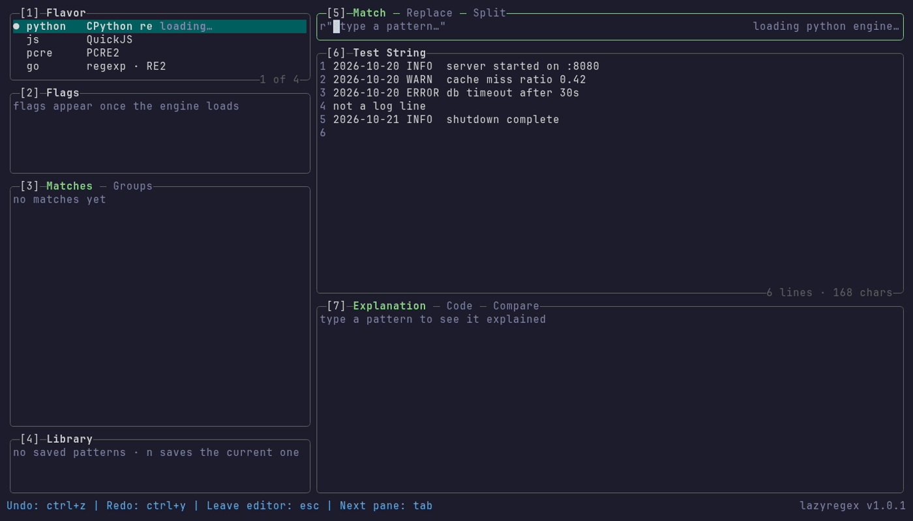

## lazyregex

A terminal UI to test and develop regular expressions against the **real engines**
of Python, JavaScript, PCRE (PHP) and Go, without leaving the terminal or opening a
website. One static binary, no runtime to install.

<p align="center"></p>

[](https://github.com/dor1202/lazyregex/releases)
[](https://github.com/dor1202/lazyregex/blob/main/LICENSE)
<!-- [](https://github.com/dor1202/lazyregex/releases) -->

---

- Matches, groups, replace and split, with highlighting in the test string.
- Plain-English explanation of the pattern, per flavor.
- A runnable code snippet for the current flavor, and a Compare tab that shows the
  same pattern's results on every flavor.
- A library of saved patterns.
- Errors are the engine's own messages, verbatim.

> v0.x of lazyregex was a Python application. v1.0 is a complete rewrite in Go; the
> Homebrew formula keeps its name, so `brew upgrade lazyregex` switches to it.

---

## Note...

Lazyregex is an idea of a frustrated developer who got the task of developing regexes and not by a big corporation with deep pockets.

It is a project that is being developed by a single person in their free time.

If you feel Lazyregex makes your regex journey a bit easier, saves you time and makes you more productive, please consider [sponsoring!](https://github.com/sponsors/dor1202)
Your donations will go a long way in keeping the project alive and beers in my fridge! 🍺

**Thank you!**

---

## Installation

### Homebrew (macOS and Linux)

```sh
brew tap dor1202/lazyregex
brew install lazyregex
```

### Scoop (Windows)

```sh
scoop bucket add lazyregex https://github.com/dor1202/scoop-lazyregex
scoop install lazyregex
```

### Chocolatey (Windows)

```sh
choco install lazyregex
```

### Debian, Ubuntu, Fedora, ...

Download the `.deb` or `.rpm` from the [releases page](https://github.com/dor1202/lazyregex/releases):

```sh
sudo dpkg -i lazyregex_*_linux_amd64.deb    # or: sudo rpm -i lazyregex_*_linux_amd64.rpm
```

### Arch Linux (AUR)

```sh
yay -S lazyregex-bin
```

### Go

```sh
go install github.com/dor1202/lazyregex/cmd/lazyregex@latest
```

Pure Go, no C toolchain needed (the WASM engines are committed to the repository).

### Binaries

Archives for Linux, macOS and Windows (amd64 and arm64) with checksums are on the
[releases page](https://github.com/dor1202/lazyregex/releases).

---

## Flavors

Each flavor runs that language's real regex engine, compiled to WebAssembly and
embedded in the binary (Go's `regexp` is linked directly). Nothing on your machine
(python, node, php) is used, and nothing needs the network.

| Flavor | Engine | Version | Offsets in |
| --- | --- | --- | --- |
| `python` (default) | CPython `re` (wasm32) | 3.14.9 | code points |
| `js` | QuickJS-ng | 0.17.0 | UTF-16 code units |
| `pcre` | PCRE2 as in PHP's `preg_*` | 10.44 (bundled with PHP 8.4) | bytes |
| `go` | Go `regexp` (RE2 syntax) | the Go toolchain the release is built with | bytes |

### Known differences

- **JavaScript runs on QuickJS-ng, not V8.** Matching is ECMAScript-exact, but it is not
  V8/Node-exact. The parity suite against Node documents what differs
  (`parity/exceptions.yaml`): so far only the **wording of syntax-error messages**
  (V8: `Unterminated group`, `Nothing to repeat`, `Invalid regular expression: /.../: ...`;
  QuickJS-ng: `expecting ')'`, `nothing to repeat`, ...). Which patterns are rejected and
  what they match is the same.
- **PCRE behaves like PHP 8.4's `preg_*`** with PCRE2 10.44, the version PHP bundles. It
  runs PCRE2's interpreter whereas PHP uses the JIT, so pathological deep recursion can
  report a different limit error. Endless recursion reports `JIT stack limit exhausted`,
  as PHP with JIT does.
- **Python runs CPython 3.14.9 (wasm32).** Repeat counts above 2147483647 (for example
  `a{0,3000000000}`) are rejected, though 64-bit CPython accepts them. The `FutureWarning`s
  that Python's `re` emits are not shown.
- **Very large inputs** (over 1 MiB of test text) are not evaluated while you type: press
  Enter to evaluate. Every evaluation has a timeout (2 s by default; 30 s for these
  large inputs).

---

## Usage

```sh
lazyregex                          # open the TUI
lazyregex -f js '(\d+)-(\d+)'      # start with a flavor and a pattern
echo 'order 12-34' | lazyregex     # piped text becomes the test string
lazyregex --explain -f pcre '^(?<y>\d{4})-\d\d$'
```

| Option | |
| --- | --- |
| `-f`, `--flavor NAME` | `python` (default), `js`, `pcre` or `go` |
| `-p`, `--pattern RE` | initial pattern (or pass it as the argument) |
| `--flags LETTERS` | python `gimsxa`, js `gdimsuvy`, pcre `gimsxnUu`, go `gimsU` |
| `--explain` | print a plain-English explanation and exit |
| `--licenses` | print the licences of lazyregex and its bundled engines |
| `--version` | print the version |

Exit codes: 0 ok, 1 runtime error, 2 usage error. When stdout is not a terminal the
TUI does not start (use `--explain`).

`config.yaml` and the pattern library (`library.yaml`) live in the `lazyregex` folder of your OS config
directory (`~/.config/lazyregex` on Linux).

---

## Keybindings

Seven panes: **1** Flavor, **2** Flags, **3** Matches / Groups, **4** Library,
**5** Pattern (Match / Replace / Split), **6** Test String, **7** Explanation / Code /
Compare. `?` shows the keys for the focused pane; the bottom bar shows the most useful.

| Key | Action |
| --- | --- |
| `tab` / `shift+tab` | next / previous pane |
| `1`-`7` | focus a pane |
| `[` `]` | previous / next tab of the pane |
| `enter` | edit the focused editor (pattern, replacement, test string) |
| `esc` | leave the editor |
| `+` `_` | widen / narrow the left column |
| `:` | command prompt (see below) |
| `?` | keybindings popup (`/` filters it) |
| `q` | quit (`ctrl+c` quits from anywhere, including editors) |

In the editors: `ctrl+z` undo, `ctrl+y` redo, plus the usual line-editing keys
(`ctrl+a`/`ctrl+e`, `ctrl+w`, `ctrl+k`, `ctrl+u`, arrows and alt/ctrl-arrows by word).
Above 1 MiB of text, `enter` evaluates.

| Pane | Keys |
| --- | --- |
| Flavor | `up` `down` move, `enter` select |
| Flags | `up` `down` move, `space` toggle |
| Matches / Groups | `enter` expand, `o` jump to the text, `y` copy value, `Y` copy all as JSON |
| Library | `enter` load, `n` save the current pattern, `d` delete |
| Explanation | `up` `down` select a row (highlights it in the pattern) |
| Code | `y` copy the snippet |
| Compare | `enter` use that flavor, `a` apply the suggested rewrite |

Commands (`:`, `tab` completes): `flavor`, `flags`, `mode`, `mouse [on|off]`,
`save <name>`, `open <name>`, `q`.

**Mouse** is on by default: click to focus a pane, select a row, switch tab or place the
cursor in an editor; the wheel scrolls the pane under the pointer; drag a border to resize.
Turn it off with `:mouse off` (or `mouse: false` in `config.yaml`) if you prefer your
terminal's own selection.

---

## Building From Source

```sh
git clone https://github.com/dor1202/lazyregex && cd lazyregex
make build        # CGO_ENABLED=0 go build -o bin/lazyregex ./cmd/lazyregex
make test
```

Only Go is needed. `make wasm` rebuilds the embedded engines from their pinned sources
(`wasm/versions.env`) and needs Docker. Maintainers: see [docs/RELEASING.md](docs/RELEASING.md).

---

## Contributors

Without the contributions from these fine folks, this project would be a total dud!

<a href="https://github.com/dor1202/lazyregex/graphs/contributors">
  
</a>

---

---

## Known Issues

This is still work in progress! If something is broken or there's a feature
that you want, please file an issue and if so inclined submit a PR!

---

## Contributions Guideline

* File an issue first prior to submitting a PR!
* Ensure all exported items are properly commented

---

## References

Big thanks to the following projects for their inspiration:

* [Textual](https://github.com/Textualize/textual)
* [k9s](https://github.com/derailed/k9s)
* [rexi](https://github.com/royreznik/rexi)

Without them, this project would not be possible.